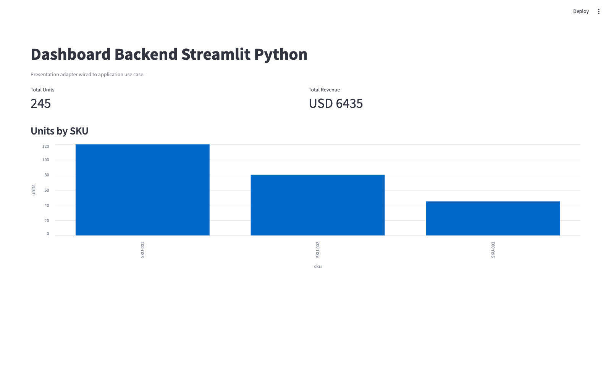
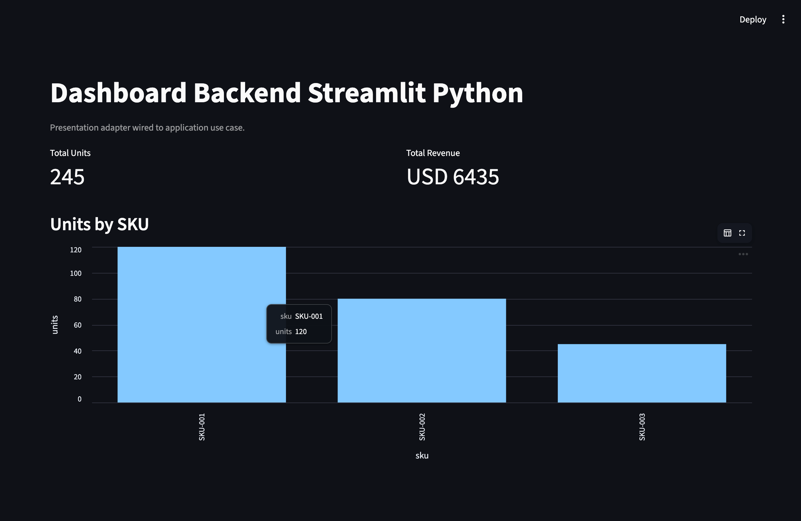

# dashboard-backend-streamlit-py

Streamlit dashboard backend con arquitectura DDD + Hexagonal, listo como seed reutilizable.



## Quickstart

```sh
uv sync --group dev
make run
make lint
make test
make test-watch
```

## Architecture

- `src/dashboard/domain` y `src/dashboard/application` encapsulan reglas y casos de uso sin dependencia de Streamlit.
- Los puertos se definen con `Protocol` en `src/dashboard/application/ports` y se implementan con adaptadores en infraestructura/presentación.
- `src/dashboard/presentation/streamlit` es un adaptador de UI reemplazable, no parte del core de negocio.

## Quality Gates

- Linting: `ruff`
- Type checking: `mypy` en modo strict
- Testing: `pytest`
- CI: `.github/workflows/quality.yml` ejecuta `make lint` y `make test` en push/PR.

## Seed Baseline

Este repositorio mantiene un baseline estable etiquetado como `seed-v0.1.0`.
Ese tag marca una semilla reusable (seed) con DDD + Hexagonal + adaptador Streamlit + quality gates.

### Crear un proyecto nuevo desde el seed tag

```sh
git archive --format=tar --prefix=my-new-dashboard/ seed-v0.1.0 | tar -x
cd my-new-dashboard
git init
uv sync --group dev
make run
```

Opcional a futuro: crear un repositorio template dedicado. Método oficial actual: iniciar desde el tag seed.

## Screenshots

Vista general:


Interacción (tooltip/hover):


Captura adicional de referencia:


